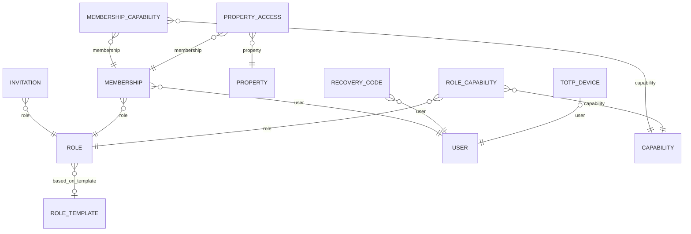
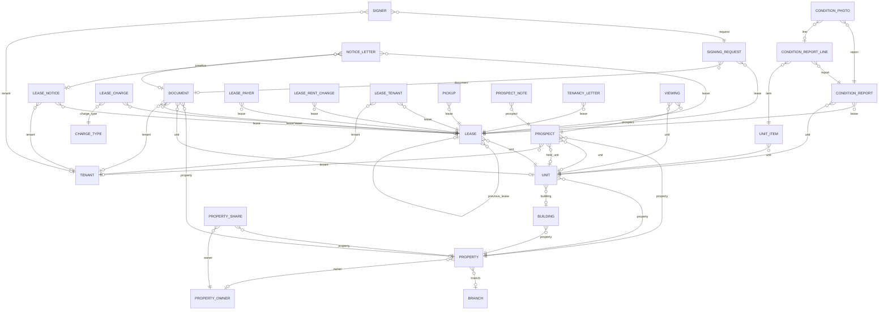
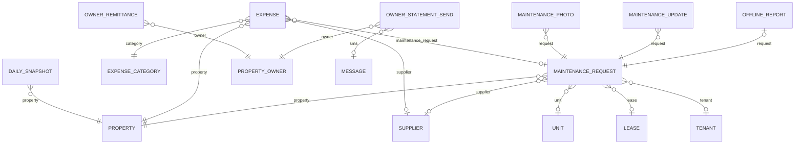
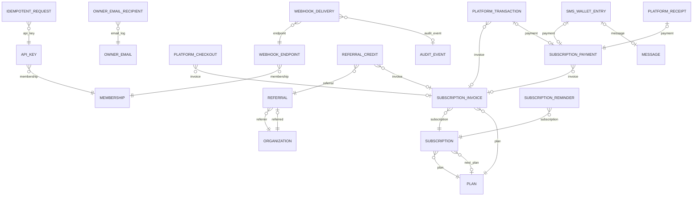

# Entity Relationship Diagram

Generated from the models by `python manage.py erd`; do not edit by hand (D-103). A test fails when the models
change and this file is not regenerated. View with any Mermaid renderer (VS Code Markdown Preview Mermaid, GitHub).

Left out to keep the diagrams readable: every table's link to `ORGANIZATION` (almost all have one), and links to
`USER` saying who created, approved or was given something; sections 1 and 5 show who belongs and who signs in.
A link `A }o--|| B : "field"` means many A rows point at one B through `A.field`; `o|` on the B side means it may
be empty.

## 1. Identity, organizations, roles, audit

Tables: AUDIT_EVENT, BRANCH, CAPABILITY, DATA_EXPORT, EMAIL_ROUTING, INVITATION, JOB_RUN, MEMBERSHIP, MEMBERSHIP_CAPABILITY, NUMBER_SEQUENCE, ORGANIZATION, OTP_CODE, PROPERTY_ACCESS, RECOVERY_CODE, ROLE, ROLE_CAPABILITY, ROLE_TEMPLATE, SYSTEM_MESSAGE_SETTING, TOTP_DEVICE, USER.

## 2. Properties, tenants, leases

Tables: BUILDING, CONDITION_PHOTO, CONDITION_REPORT, CONDITION_REPORT_LINE, DOCUMENT, IMPORT_BATCH, LEASE, LEASE_CHARGE, LEASE_NOTICE, LEASE_PAYER, LEASE_RENT_CHANGE, LEASE_TENANT, NOTICE_LETTER, PICKUP, PROPERTY, PROPERTY_OWNER, PROPERTY_SHARE, PROSPECT, PROSPECT_NOTE, SIGNER, SIGNING_REQUEST, TENANCY_LETTER, TENANT, UNIT, UNIT_ITEM, VIEWING.

## 3. Billing, payments, M-Pesa, bank, meters

Tables: BANK_TRANSACTION, CHARGE_TYPE, CODE_CHECK, DARAJA_CREDENTIALS, DEPOSIT_ENTRY, FOLLOW_UP, INVOICE, INVOICE_LINE, LATE_FEE, LEDGER_ENTRY, METER, METER_CHARGE, METER_READING, METER_UNIT, MPESA_TRANSACTION, OFFLINE_ROUND, PAYMENT, PAYMENT_ACCOUNT, PAYMENT_ALLOCATION, PAY_LINK, PROPERTY_PAYMENT_ACCOUNT, RECEIPT, SCAN, SETUP_VIDEO, STATEMENT_IMPORT, STK_REQUEST, WATER_PLAN, WATER_PLAN_UNIT.

```mermaid
erDiagram
    BANK_TRANSACTION }o--|| PAYMENT_ACCOUNT : "payment_account"
    BANK_TRANSACTION }o--|| STATEMENT_IMPORT : "statement"
    BANK_TRANSACTION }o--o| LEASE : "suggested_lease"
    BANK_TRANSACTION |o--o| PAYMENT : "payment"
    CODE_CHECK |o--|| PAYMENT : "payment"
    DARAJA_CREDENTIALS |o--|| PAYMENT_ACCOUNT : "payment_account"
    DEPOSIT_ENTRY }o--|| LEASE : "lease"
    DEPOSIT_ENTRY |o--o| DEPOSIT_ENTRY : "counterpart"
    DEPOSIT_ENTRY |o--o| LEDGER_ENTRY : "ledger_entry"
    DEPOSIT_ENTRY |o--o| DEPOSIT_ENTRY : "reversal_of"
    DEPOSIT_ENTRY }o--o| CONDITION_REPORT : "condition_report"
    FOLLOW_UP }o--|| LEASE : "lease"
    INVOICE }o--|| LEASE : "lease"
    INVOICE_LINE }o--|| INVOICE : "invoice"
    INVOICE_LINE }o--|| LEASE : "lease"
    INVOICE_LINE }o--|| CHARGE_TYPE : "charge_type"
    INVOICE_LINE }o--o| METER_CHARGE : "meter_charge"
    LATE_FEE }o--|| LEASE : "lease"
    LATE_FEE |o--|| INVOICE : "invoice"
    LATE_FEE |o--o| INVOICE : "fee_invoice"
    LEDGER_ENTRY }o--|| LEASE : "lease"
    LEDGER_ENTRY }o--o| INVOICE : "invoice"
    LEDGER_ENTRY }o--o| PAYMENT : "payment"
    LEDGER_ENTRY |o--o| LEDGER_ENTRY : "reversal_of"
    METER }o--|| PROPERTY : "property"
    METER_CHARGE }o--|| METER_READING : "reading"
    METER_CHARGE }o--|| LEASE : "lease"
    METER_CHARGE }o--|| UNIT : "unit"
    METER_READING }o--|| METER : "meter"
    METER_READING }o--o| METER_READING : "previous"
    METER_UNIT }o--|| METER : "meter"
    METER_UNIT }o--|| UNIT : "unit"
    MPESA_TRANSACTION }o--|| PAYMENT_ACCOUNT : "payment_account"
    MPESA_TRANSACTION }o--o| LEASE : "suggested_lease"
    MPESA_TRANSACTION |o--o| PAYMENT : "payment"
    OFFLINE_ROUND }o--|| PROPERTY : "property"
    PAYMENT }o--|| LEASE : "lease"
    PAYMENT }o--o| TENANT : "tenant"
    PAYMENT }o--o| PAYMENT_ACCOUNT : "payment_account"
    PAYMENT_ALLOCATION }o--|| PAYMENT : "payment"
    PAYMENT_ALLOCATION }o--|| INVOICE : "invoice"
    PAY_LINK |o--|| LEASE : "lease"
    PROPERTY_PAYMENT_ACCOUNT }o--|| PROPERTY : "property"
    PROPERTY_PAYMENT_ACCOUNT }o--|| PAYMENT_ACCOUNT : "payment_account"
    RECEIPT |o--|| PAYMENT : "payment"
    SCAN }o--o| PROPERTY : "property"
    STATEMENT_IMPORT }o--|| PAYMENT_ACCOUNT : "payment_account"
    STK_REQUEST }o--|| PAYMENT_ACCOUNT : "payment_account"
    STK_REQUEST }o--|| LEASE : "lease"
    STK_REQUEST }o--o| PAY_LINK : "pay_link"
    STK_REQUEST |o--o| MPESA_TRANSACTION : "transaction"
    WATER_PLAN |o--|| PROPERTY : "property"
    WATER_PLAN_UNIT }o--|| WATER_PLAN : "plan"
    WATER_PLAN_UNIT }o--|| UNIT : "unit"
```

## 4. Expenses, repairs, owner reports

Tables: DAILY_SNAPSHOT, EXPENSE, EXPENSE_CATEGORY, MAINTENANCE_PHOTO, MAINTENANCE_REQUEST, MAINTENANCE_TARGET, MAINTENANCE_UPDATE, OFFLINE_REPORT, OWNER_REMITTANCE, OWNER_STATEMENT_SEND, SUPPLIER.

## 5. Messages, tenant and owner portals, assistant, support

Tables: ANNOUNCEMENT, APP_OPEN, CONSENT_RECORD, EMAIL_ACCOUNT, INCIDENT, INCIDENT_UPDATE, KNOWLEDGE_ENTRY, MESSAGE, MESSAGE_TEMPLATE, NOTIFICATION_PREFERENCE, NOTIFICATION_TYPE_SETTING, ORGANIZATION_NOTIFICATION_RULE, OWNER_ACCOUNT, OWNER_INVITATION, PLATFORM_WHATS_APP, PORTAL_INVITATION, PORTAL_MESSAGE, PUSH_SUBSCRIPTION, QUESTION, RENEWAL_OFFER, SMS_ACCOUNT, SUPPORT_REQUEST, TENANT_ACCOUNT, USSD_PIN, WHATS_APP_ACCOUNT.

```mermaid
erDiagram
    CONSENT_RECORD }o--o| TENANT : "tenant"
    INCIDENT_UPDATE }o--|| INCIDENT : "incident"
    KNOWLEDGE_ENTRY }o--o| PROPERTY : "property"
    MESSAGE }o--o| TENANT : "tenant"
    MESSAGE }o--o| LEASE : "lease"
    MESSAGE }o--o| INVOICE : "invoice"
    MESSAGE }o--o| PAYMENT : "payment"
    MESSAGE }o--o| ANNOUNCEMENT : "announcement"
    NOTIFICATION_PREFERENCE }o--o| TENANT : "tenant"
    OWNER_ACCOUNT }o--|| PROPERTY_OWNER : "owner"
    OWNER_ACCOUNT }o--|| USER : "user"
    OWNER_INVITATION }o--|| PROPERTY_OWNER : "owner"
    PORTAL_INVITATION }o--|| TENANT : "tenant"
    PORTAL_MESSAGE }o--|| LEASE : "lease"
    PORTAL_MESSAGE }o--|| TENANT : "tenant"
    PORTAL_MESSAGE }o--|| USER : "author"
    QUESTION }o--o| TENANT : "tenant"
    RENEWAL_OFFER }o--|| LEASE : "lease"
    RENEWAL_OFFER }o--o| LEASE : "successor"
    TENANT_ACCOUNT }o--|| TENANT : "tenant"
    TENANT_ACCOUNT }o--|| USER : "user"
```

## 6. Platform: plans, the API, growth and the console

Tables: API_KEY, BILLING_POLICY, DEMO_REQUEST, IDEMPOTENT_REQUEST, OWNER_EMAIL, OWNER_EMAIL_RECIPIENT, PLAN, PLATFORM_ANNOUNCEMENT, PLATFORM_CHECKOUT, PLATFORM_EXPENSE, PLATFORM_PAY_SWITCH, PLATFORM_RECEIPT, PLATFORM_SEQUENCE, PLATFORM_STAFF, PLATFORM_TRANSACTION, REFERRAL, REFERRAL_CODE, REFERRAL_CREDIT, REFERRAL_POLICY, SIGNUP_SOURCE, SMS_WALLET, SMS_WALLET_ENTRY, SUBSCRIPTION, SUBSCRIPTION_INVOICE, SUBSCRIPTION_PAYMENT, SUBSCRIPTION_REMINDER, WEBHOOK_DELIVERY, WEBHOOK_ENDPOINT.

